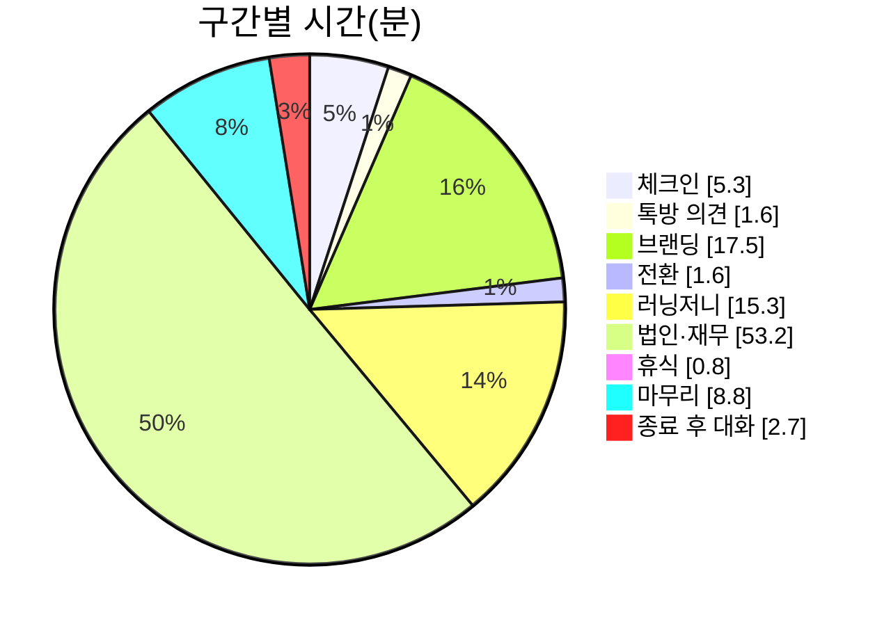

> **1:46:56** 회의 · 확정 **0** · 확정(추정) **0** · 제안 **2** · 보류 **1** · 후속 요청 **6** · 전사 교정 **20**종 적용 / **13**종 확인 대기

분류는 AI 1차이고, 인용은 전사 원문 그대로다(교정은 아래 표에 따로 둔다).

## 타임라인

```mermaid
gantt
    dateFormat HH:mm:ss
    axisFormat %H:%M
    section 구간
    체크인 :s0, 00:00:00, 321s
    톡방 의견 :s1, 00:05:21, 99s
    브랜딩 :s2, 00:07:00, 1051s
    전환 :s3, 00:24:31, 95s
    러닝저니 :s4, 00:26:06, 920s
    법인·재무 :s5, 00:41:26, 1110s
    휴식 :s6, 00:59:56, 48s
    법인·재무 :s7, 01:00:44, 2082s
    마무리 :s8, 01:35:26, 527s
    종료 후 대화 :s9, 01:44:13, 163s
    section 결정
    T1-D1 제안 :milestone, d0, 00:05:21, 0s
    T1-D2 제안 :milestone, d1, 00:23:26, 0s
    T1-D3 보류 :milestone, d2, 01:35:58, 0s
    section 후속 요청
    T1-A1 :milestone, a0, 01:42:39, 0s
    T1-A2 :milestone, a1, 01:42:39, 0s
    T1-A3 :milestone, a2, 01:43:10, 0s
    T1-A4 :milestone, a3, 01:43:42, 0s
    T1-A5 :milestone, a4, 01:43:42, 0s
    T1-A6 :milestone, a5, 01:44:13, 0s
```

## 시간 배분

## 결정
| ID | 시각 | 유형 | 내용 | 원문 인용 | 확인 질문 | 응답 기록 |
|---|---|---|---|---|---|---|
| T1-D1 | 5:21 | 제안 | 톡방(재무 공유·아카이빙용) 신설 의견 수렴 | “다른 속방을 만들어 놓는 게 어떤가에 대한 의견이 나왔어서” | 있음(의견을 좀 좋아하고 싶어요[ASR]) | "네."(브랜딩 넘어가도 되는지에 대한 응답) — 톡방 자체의 결론 기록 없음 |
| T1-D2 | 23:26 | 제안 | 브랜딩은 가볍게 마무리, 슬로건 문장 5개 삭제 | “슬로건 문장 5개는 일단 지우는 걸로 생각을 하고” | 있음(22:55 "어떠신가요?") | 질문으로 되받음 "누가 말한 것처럼 하자는 거죠?" — 동의 기록 없음 |
| T1-D3 | 1:35:58 | 보류 | 법인·재무 방향은 이번에 결정하지 않고 다음으로 넘김 | “다음에 한 차례 더 넘겨서 얘기를 해보는 게 좋지 않을까라고 생각해요” | — | — |

## 후속 요청
| ID | 시각 | 내용 | 원문 인용 | 기한(발화) | 담당(발화) | 이행 |
|---|---|---|---|---|---|---|
| T1-A1 | 1:42:39 | 무드 아카이브 정리 | “무드와 파이브는 정리해서 구르노한테 무드와 파이브 부탁드리고요” | 미언급 | "구르노"[ASR 표기] | ☐ |
| T1-A2 | 1:42:39 | 재무 프로세스 정리 | “재무 상인 방은 재무 관련 내용 프로세스 정리하는 거 해서 와주시면 좋을 것 같아요” | 가능하면 다음 주(1:43:10) | 재무 담당 방[ASR] | ☐ |
| T1-A3 | 1:43:10 | 길어질 경우 사전 공유 | “좀 길어질 것 같다고 하면 알려주세요” | — | 미언급 | ☐ |
| T1-A4 | 1:43:42 | TS 일정(예비군) 고려 | “고려를 해주시고” | — | 전원 | ☐ |
| T1-A5 | 1:43:42 | 각자 의견 서치·공부 | “좀 서치를 해보면 좋을 것 같아요” | 미언급 | 각자 | ☐ |
| T1-A6 | 1:44:13 | 파트 팀 운영 고민 | “만약에 파트 팀 운영도 어떻게 하면 좋을지에 대한 고민도 같이 해서 와주시면 좋을 것 같아요” | 미언급 | 브루노(언급) | ☐ |

## 전사 교정
적용된 교정(사람 확인 또는 신뢰도 0.9 이상).

| 시각 | 전사 원문 | 교정 | 근거 | 방법 |
|---|---|---|---|---|
| 3:48 | 무드 아카이블 | **무드 아카이브** | 프로젝트 이름 '무드 아카이브'(Ro 확인)의 다른 오인식 | llm · auto |
| 14:05 | 러닝전이 | **러닝저니** | 용어집 '러닝저니'(팀 해외 학습 여정) — 같은 회의에서 반복 등장 | llm · auto |
| 25:33 | 러밍전이 | **러닝저니** | 용어집 '러닝저니'(팀 해외 학습 여정) — 같은 회의에서 반복 등장 · 아젠다 소개 문장 | llm · auto |
| 26:06 | 러밍전이 | **러닝저니** | 용어집 '러닝저니'(팀 해외 학습 여정) — 같은 회의에서 반복 등장 | llm · auto |
| 27:13 | 러닝전이 | **러닝저니** | 용어집 '러닝저니'(팀 해외 학습 여정) — 같은 회의에서 반복 등장 | llm · auto |
| 30:55 | 러닝전 | **러닝저니** | 용어집 '러닝저니'(팀 해외 학습 여정) — 같은 회의에서 반복 등장 · '러닝저니에서 프로젝트를' | llm · auto |
| 35:16 | 러닝존이 | **러닝저니** | 용어집 '러닝저니'(팀 해외 학습 여정) — 같은 회의에서 반복 등장 · '작년 스페인 러닝저니를 돌아왔을 때' | llm · auto |
| 44:19 | 과수금 | **가수금** | 회계 용어 가수금 — '각자 가수금에서 처리' 문맥, 같은 회의에 바른 표기 20회 | llm · auto |
| 45:55 | 가소금 | **가수금** | 회계 용어 가수금 — 같은 회의에 바른 표기 20회 | llm · auto |
| 1:01:14 | 러닝전이 | **러닝저니** | 용어집 '러닝저니'(팀 해외 학습 여정) — 같은 회의에서 반복 등장 · '러닝저니 다녀와서' | llm · auto |
| 1:03:53 | 무더아카이프 | **무드 아카이브** | 프로젝트 이름 '무드 아카이브'(Ro 확인)의 다른 오인식 | llm · auto |
| 1:18:18 | 무드 암카이브 | **무드 아카이브** | 프로젝트 이름 '무드 아카이브'(Ro 확인)의 다른 오인식 | llm · auto |
| 1:23:39 | 구르노 | **브루노** | 사람 | lexicon · auto |
| 1:24:42 | 가수권 | **가수금** | '가수금을 추가로 납입' — 같은 회의에 바른 표기 20회 | llm · auto |
| 1:31:04 | 모두 아카이브 | **무드 아카이브** | 프로젝트 이름 '무드 아카이브'(Ro 확인)의 다른 오인식 · '○○를 제외한 나머지가 안정화가 안 됐어' | llm · auto |
| 1:38:02 | 구르노 | **브루노** | 사람 | lexicon · auto |
| 1:39:34 | 무다학하이브 | **무드 아카이브** | 프로젝트 이름 '무드 아카이브'(Ro 확인)의 다른 오인식 · 프로젝트 나열(교육 프로젝트, PLL, ○○) | llm · auto |
| 1:42:39 | 무드와 파이브 | **무드 아카이브** | 프로젝트 이름 · T1-A1 항목명 정정 | human · confirmed |
| 1:42:39 | 구르노 | **브루노** | 사람 · T1-A1 담당 = 브루노 | human · confirmed |
| 1:42:39 | 재무 상인 방 | **재무 법인 방** | 카톡방 이름 · T1-A2 장소 정정 | human · confirmed |

확인 대기(적용 안 됨 — 아는 사람이 맞는지 봐 주세요).

| 시각 | 전사 원문 | 제안 | 근거 |
|---|---|---|---|
| 5:21 | 제모 | 재무 | 공지방에 올리는 내용·'제모팀'·'제모랑 파트 팀' 문맥이 재무와 맞음. 사람 확인 필요 |
| 8:43 | 필드폰 | ? | 뜻을 특정할 수 없음(폼/피드백 계열로 추정되나 근거 부족) |
| 23:26 | 필드폰 | ? | 뜻을 특정할 수 없음 |
| 24:00 | 비정립팀 | ? | 뜻을 특정할 수 없음 |
| 26:06 | 버빙 | 법인 | 아젠다가 러닝저니 하나·○○ 하나인데 뒤 구간이 법인·재무 논의. 사람 확인 필요 |
| 27:13 | 늙크크 | ? | 뜻을 특정할 수 없음 |
| 29:51 | 러닝잔이 | 러닝저니 | 용어집 '러닝저니'(팀 해외 학습 여정) — 같은 회의에서 반복 등장 · 바로 옆에 달리기(러닝) 얘기가 섞여 있어 확인 필요 |
| 30:55 | 러닝련이 | 러닝저니 | 용어집 '러닝저니'(팀 해외 학습 여정) — 같은 회의에서 반복 등장 |
| 45:55 | 러닝전일 | 러닝저니 | 용어집 '러닝저니'(팀 해외 학습 여정) — 같은 회의에서 반복 등장 · '러닝저니에 간다' |
| 1:26:50 | 리스트 | 리스크 | '○○가 많아서 … 이거 진짜 안 될 것 같은데' 문맥. 리스트도 말이 되므로 확인 필요 |
| 1:41:39 | 문어카이브 | 무드 아카이브 | 프로젝트 이름 '무드 아카이브'(Ro 확인)의 다른 오인식 · 뒤 글자와 붙어 인식돼 경계가 불확실 |
| 1:43:42 | 제모 | 재무 | '제모팀' → 재무팀으로 보임. 사람 확인 필요 |
| 1:44:13 | 제모 | 재무 | '브루노가 제모랑 파트 팀까지 맡게' → 재무로 보임. 사람 확인 필요 |
