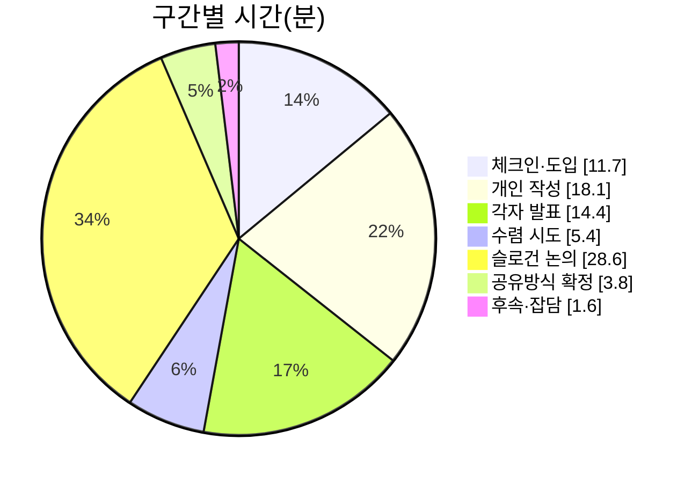

> **1:23:39** 회의 · 확정 **2** · 확정(추정) **1** · 제안 **2** · 보류 **0** · 후속 요청 **5** · 전사 교정 **7**종 적용 / **6**종 확인 대기

분류는 AI 1차이고, 인용은 전사 원문 그대로다(교정은 아래 표에 따로 둔다).

## 타임라인

```mermaid
gantt
    dateFormat HH:mm:ss
    axisFormat %H:%M
    section 구간
    체크인·도입 :s0, 00:00:00, 703s
    개인 작성 :s1, 00:11:43, 1087s
    각자 발표 :s2, 00:29:50, 867s
    수렴 시도 :s3, 00:44:17, 322s
    슬로건 논의 :s4, 00:49:39, 1714s
    공유방식 확정 :s5, 01:18:13, 230s
    후속·잡담 :s6, 01:22:03, 96s
    section 결정
    T2-D1 제안 :milestone, d0, 00:44:47, 0s
    T2-D2 제안 :milestone, d1, 00:53:15, 0s
    T2-D3 확정(추정) :milestone, d2, 01:17:08, 0s
    T2-D4 확정 :milestone, crit, d3, 01:21:32, 0s
    T2-D5 확정 :milestone, crit, d4, 01:22:35, 0s
    section 후속 요청
    T2-A1 :milestone, a0, 01:19:49, 0s
    T2-A2 :milestone, a1, 01:20:25, 0s
    T2-A3 :milestone, a2, 00:47:32, 0s
    T2-A4 :milestone, a3, 01:22:35, 0s
    T2-A5 :milestone, a4, 01:23:07, 0s
```

## 시간 배분

## 결정
| ID | 시각 | 유형 | 내용 | 원문 인용 | 확인 질문 | 응답 기록 |
|---|---|---|---|---|---|---|
| T2-D1 | 44:47 | 제안 | 팀 정체성 키워드 수렴(다양성·시야 활용) | “이렇게 수렴되는 게 조금 괜찮은지?” | 있음(4회 재질문: 44:47/45:50/46:23/49:05) | "네","너무 동의하는 거 같아요"(44:17) 2건 · 46:23 "두 간밖에 대답을 안 했잖아"[ASR] |
| T2-D2 | 53:15 | 제안 | 브랜딩 슬로건을 만드는 것 | “브랜딩 슬로번을 만드는 것은 다들 괜찮으신가요?” | 있음 | "좋습니다." 1건 + 형식에 대한 반대 의견 발화(같은 블록) |
| T2-D3 | 1:17:08 | 확정(추정) | 공모전은 하지 않음 | “저희는 안 만들었죠” | 있음(1:17:08 "만장일 수인가요?"[ASR]) | "응" — 단 1:17:38 에서 "없다 없다.있다." 혼재 |
| T2-D4 | 1:21:32 | 확정 | 금요일까지 각자 한 문장+맥락 공유, 다음 TM에서 정함 | “3, 2, 1. 없어요?” | 있음("손!") | "없어요." |
| T2-D5 | 1:22:35 | 확정 | 세션 후 넥스트 액션 확인 | “방금 넥스트잭체니 정해졌죠?네” | 있음 | "네" |

## 후속 요청
| ID | 시각 | 내용 | 원문 인용 | 기한(발화) | 담당(발화) | 이행 |
|---|---|---|---|---|---|---|
| T2-A1 | 1:19:49 | 슬로건 한 문장+맥락 공유 | “그러면 일단은 이번 주 금요일까지” | 이번 주 금요일 | 각자 | ☐ |
| T2-A2 | 1:20:25 | 다음 TM 때 맥락 공유·결정 | “다음주에 TM 때 맥락 공유하고 실시간으로 좀 의견 나누면서” | 다음 주 월요일 TM | 전원 | ☐ |
| T2-A3 | 47:32 | 퓨처 게임 과제 | “여러분 내일 퓨처 게임 과제 해오시면 돼요” | 내일 | 여러분 | ☐ |
| T2-A4 | 1:22:35 | "사이트 비집 그거"(ASR 의심) | “금요일까지 사이트 비집 그거 하셔야 됩니다” | 금요일 | 미언급 | ☐ |
| T2-A5 | 1:23:07 | 섭외 | “월요일까지는 섭외를 해야 된다네” | 월요일 | 미언급 | ☐ |

## 전사 교정
적용된 교정(사람 확인 또는 신뢰도 0.9 이상).

| 시각 | 전사 원문 | 교정 | 근거 | 방법 |
|---|---|---|---|---|
| 53:15 | 슬로번 | **슬로건** | 같은 회의에 '슬로건' 반복 등장, 다른 해석 없음 | llm · auto |
| 55:11 | 러닝전이 | **러닝저니** | 용어집 '러닝저니'(팀 해외 학습 여정) — 같은 회의에서 반복 등장 · '베를린 러닝저니' | llm · auto |
| 1:17:08 | 만장일 수 | **만장일치** | 확인 질문 문구 확정. T2-D3는 전사 의심은 해소됐으나 1:17:38 "없다 없다.있다." 등 의견 혼재로 확정 여부는 외부 판정 | human · confirmed |
| 1:18:13 | 한 분당 | **한 문장** | Ro 확인. 1:19:49 "한 문장으로 정리된 것을 공유"에도 독립 근거 | human · confirmed |
| 1:18:13 | 단척방 | **단톡방** | 공유 채널 = 단톡방 | human · confirmed |
| 1:22:35 | 넥스트잭체니 | **넥스트 액션** | T2-D5 확정 유지(전사 의심 해소) | human · confirmed |
| 1:22:35 | 사이트 비집 그거 | **site visit** | 레인에서 하는 과제 · T2-A4 항목명 정정 | human · confirmed |

확인 대기(적용 안 됨 — 아는 사람이 맞는지 봐 주세요).

| 시각 | 전사 원문 | 제안 | 근거 |
|---|---|---|---|
| 8:24 | 닿을지 | 담을지 | '강점과 앞으로의 모습을 어떻게 ○○ 정할 필요' 문맥. 확인 필요 |
| 38:16 | 먹고자 | 얻고자 | 같은 회의에 '얻고자' 10회. 확인 필요 |
| 46:23 | 두 간 | 두 명 | '○○밖에 대답을 안 했잖아', '대답한 사람이 ○○만' — 사람 수. 확인 필요 |
| 50:09 | 분장 | 문장 | '브랜딩 ○○을 만드는 게 이 세션의 목적' — 슬로건 문장. 확인 필요 |
| 56:14 | 러닝존이 | 러닝저니 | 용어집 '러닝저니'(팀 해외 학습 여정) — 같은 회의에서 반복 등장 · 주어 경계가 불확실 |
| 1:17:38 | 지갑띠 | ? | 돈과 관련된 낱말로 보이나 특정할 수 없음 |
